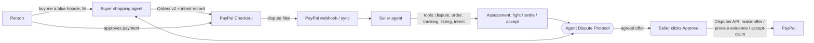

# DisputeShield

**AI agents that settle PayPal disputes for small sellers, including directly with the buyer's own AI shopping agent.**

- **Live demo:** RENDER_URL (free plan: the first visit can take ~50 seconds to wake up)
- **Demo video:** VIDEO_URL
- Built for the PayPal AI Hackathon with the PayPal sandbox and Claude.

## The problem

AI shopping agents are starting to buy on people's behalf. They will pick the wrong size, miss a line in a listing, or misread what their human wanted, and the result is a dispute. For a small seller, every dispute costs time and fees. A rising dispute ratio can lead to an account review and funds held for up to 180 days. Large merchants pay chargeback services to handle this; small sellers handle it alone.

## What DisputeShield does

**Seller agent.** When a PayPal dispute arrives (webhook or sync), the agent investigates it using PayPal's dispute, order and Seller Protection data, the shipment tracking, the product listing and, if an AI agent made the purchase, that agent's purchase-intent record. It recommends **Fight**, **Settle** or **Accept**, with a win probability, the reasons, and drafted evidence or a suggested offer.

**Buyer shopping agent.** A person types "Buy me a blue hoodie in size M, under $40". The agent picks the item, creates a PayPal order, and records exactly what the person asked for. The person approves the payment in PayPal's own checkout window; the agent never holds credentials.

**Agent-to-agent settlement.** For disputes worth settling, the seller's agent and the buyer's agent negotiate over a small open protocol (Agent Dispute Protocol): offer, counter, accept or reject, at most six turns. The seller agent can't offer more than 60% back unless the item is returned.

**The seller stays in control.** Nothing that moves money happens until the seller clicks Approve. One click then sends the agreed offer (`make-offer`, with a summary of the negotiation as its note), the evidence (`provide-evidence`) or the acceptance (`accept-claim`) through the PayPal Disputes API. Buttons follow what PayPal currently allows on each dispute.

**Seller console.** All disputes in an AG Grid table with the AI's recommendation, win chance, Seller Protection status, negotiation status and response deadline, plus orders with one-click tracking upload, account health (dispute ratio, open cases, fees avoided), the negotiation transcript and an activity log.

## Try it (about 5 minutes)

Open RENDER_URL. You need the sandbox buyer login below to pay. It's a PayPal **sandbox** test account with test money only.

| | |
|---|---|
| Sandbox buyer email | `sb-cxty153715039@personal.example.com` |
| Sandbox buyer password | `g<2q9cMW` |

1. **Buyer agent** (`/shop`): click "Buy me a blue hoodie in size M, under $40". When the purchase card appears, click the PayPal button and pay with the sandbox buyer.
2. **Seller console** (`/console`): the order appears. Click **Ship + upload tracking** (the tracking is sent to PayPal), then **Mark delivered**.
3. **Open a dispute:** on `/shop`, write a complaint under the order ("fits like an S") and click **Tell my agent**. Then log in to [sandbox.paypal.com](https://www.sandbox.paypal.com) as the sandbox buyer, open the payment and choose **Report a problem → Item not as described**.
4. **Seller console:** click **Sync with PayPal** (or wait up to 30 seconds). The seller agent assesses the dispute.
5. Click **Negotiate with buyer's agent** and watch the two agents agree. Then click **Approve settlement**. The offer goes to PayPal, and the buyer can accept it in the sandbox case page.

If you only want to look around, the seller console already shows existing sandbox disputes after a sync. The public demo caps AI agent runs at 40 per hour.

## How it works



## PayPal APIs used (sandbox)

| API | Used for |
|---|---|
| OAuth 2.0 client credentials | Server-side access token (`src/lib/paypal.ts`) |
| Orders v2: create, capture, get | The buyer agent's checkout and order lookups |
| Orders v2 tracking (`/v2/checkout/orders/{id}/track`) | Uploading shipment tracking, which Seller Protection needs |
| JavaScript SDK (PayPal Buttons via `@paypal/react-paypal-js`) | The person approves the agent's checkout |
| Disputes v1: list, get, `make-offer`, `provide-evidence`, `accept-claim` | Syncing disputes and carrying out the seller's approved decision |
| Disputes v1 sandbox: `require-evidence`, `adjudicate` | Demo controls that walk a dispute through PayPal's decision |
| Webhooks: `CUSTOMER.DISPUTE.*` with signature verification | Disputes arrive without polling (`src/app/api/webhooks/paypal/route.ts`) |

**What we learned from the sandbox:**
- `GET /v1/customer/disputes` leaves out disputes under PayPal review unless `start_time` is set, and rejects a start of 180 days or more. We send 179 days.
- A seller `send-message` moves a dispute to "waiting for buyer", which blocks `make-offer`. The negotiation therefore stays inside DisputeShield, and one `make-offer` carries the agreed terms and a summary of the negotiation.
- Each dispute's links show which actions PayPal currently allows, and the console enables its buttons to match.

## AI used

- **Claude** through the official Anthropic SDK (`@anthropic-ai/sdk`). The demo runs `claude-sonnet-5-5`; set `CLAUDE_MODEL` to change it. Requests use adaptive thinking at medium effort and server-side refusal fallbacks.
- **Seller agent** (`src/lib/agents/seller.ts`): a tool-using agent built on the SDK's tool runner. Its tools read the live PayPal dispute, the order and tracking, the listing, the purchase-intent record and shop health. It ends by filing a structured assessment.
- **Buyer agent** (`src/lib/agents/buyer.ts`): searches the catalog and calls a tool that creates the PayPal order and the purchase-intent record.
- **Negotiation** (`src/lib/agents/negotiation.ts`): the two agents take structured turns (offer, counter, accept, reject); each sees the shared facts plus its own private notes.
- **Guardrails:** agents read PayPal data but never move money. Every money-moving call runs only from `/api/disputes/[id]/approve` after the seller clicks. The seller agent has a refund ceiling (`SELLER_MAX_REFUND_PCT`). A global hourly cap on agent runs (`AGENT_RUNS_PER_HOUR`) limits cost.

**Other tools:** Next.js 16, AG Grid Community (dispute and order tables), Render (hosting, `render.yaml`), motion (animations).

## Run it locally

Requirements: Node 20.9+, a free PayPal Developer account, an Anthropic API key.

1. **PayPal sandbox app.** At [developer.paypal.com](https://developer.paypal.com), go to Testing Tools → Sandbox Accounts and create a **US** Business account (seller) and a **US** Personal account (buyer). Then go to Apps & Credentials → Sandbox → Create App, linked to the US Business account, and copy its client ID and secret. Use US accounts: payments between two India-registered sandbox accounts fail.
2. **Configure and check:**
   ```bash
   cp .env.example .env.local   # fill PAYPAL_CLIENT_ID, PAYPAL_CLIENT_SECRET, ANTHROPIC_API_KEY
   npm install
   npm run check                # verifies PayPal Orders, Disputes and Webhooks access and Claude
   npm run dev                  # http://localhost:3000
   ```
3. Follow **Try it** above using your own sandbox buyer.

**Webhooks (optional):** locally the console polls PayPal every 30 seconds. When deployed, add a webhook in your PayPal app for `CUSTOMER.DISPUTE.CREATED`, `CUSTOMER.DISPUTE.UPDATED` and `CUSTOMER.DISPUTE.RESOLVED` pointing to `https://<host>/api/webhooks/paypal`, and set `PAYPAL_WEBHOOK_ID`.

**Deploy on Render:** New → Blueprint → this repo. `render.yaml` defines the service; paste the secrets when prompted.

## Project layout

```
src/lib/paypal.ts              PayPal REST client (Orders, Tracking, Disputes, Webhooks)
src/lib/agents/seller.ts       Seller agent: investigates and assesses a dispute
src/lib/agents/buyer.ts        Buyer shopping agent: PayPal checkout + purchase intent
src/lib/agents/negotiation.ts  Agent Dispute Protocol negotiation loop
src/lib/disputes.ts            Sync, agent orchestration, approved actions
src/lib/ratelimit.ts           Hourly cap on agent runs for the public demo
src/app/console                Seller console (AG Grid)
src/app/shop                   Buyer agent UI with PayPal Buttons
src/app/api                    Route handlers
scripts/check-sandbox.ts       Setup check
```

Data is kept in `data/db.json` (single-seller demo). `npm run reset-data` starts over.

## Known limitations

- Single seller and a JSON file store: this is a demo, not multi-tenant. On Render's free plan, local orders are lost when the service sleeps; disputes come back from PayPal on the next sync.
- `provide-evidence` is implemented but only works once PayPal opens the evidence stage (claim or PayPal request). The sandbox controls can trigger that stage.
- The Agent Dispute Protocol is our own small JSON protocol, not an industry standard.

## License

MIT, see [LICENSE](LICENSE).
